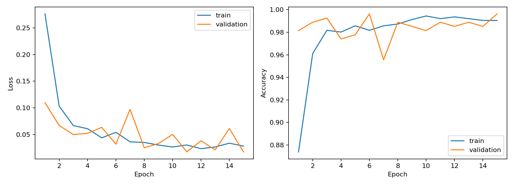
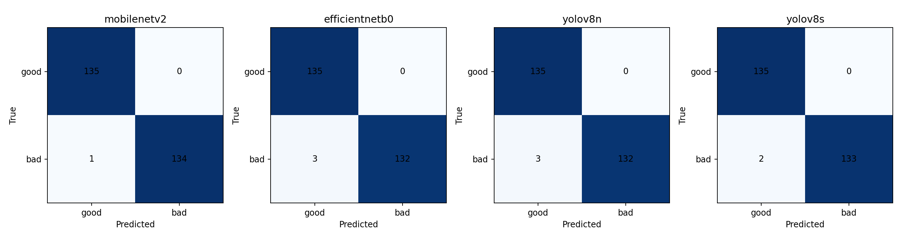

# Task 2 — MobileNetV2 baseline

> **Audit note:** this is a reformatting of the saved results of 25 October 2026, **not a new training run**. The experiments used max 15 epochs, batch size 16, early stopping patience 4, input 224×224 for all models (including YOLO), whereas the teacher's detailed requirements specify 50/32/5 and 640×640 for YOLO. No metrics have been altered.

## Method

ImageNet-pretrained MobileNetV2, base frozen, shared custom head (global average pooling → Dense(128, ReLU) → Dropout(0.3) → Dense(1, sigmoid)). Dataset split by source document: 1,260 train, 270 validation and 270 test images; seed **2473986**, positive class **bad**. RGB images 224×224, Adam learning rate 0.001.

## Test results

Accuracy **99.63%**; bad-class precision **1.0000**, recall **0.9926**, F1 **0.9963**; macro precision/recall/F1 approximately **0.9963**. Confusion matrix (true good,bad × predicted good,bad): `[[135,0],[1,134]]`. CPU latency **37.69 ms/image** (20 warm-up predictions, 100 timed calls); checkpoint **11.06 MiB**, **2,422,081** parameters, **247.9 s** training, **15 actual epochs**.

## Training curves and interpretation

Training loss fell from **0.2761** to **0.0283**; minimum validation loss **0.0173** at epoch 15. Validation loss fluctuated but did not show sustained strong divergence. Dropout active only during training can make training accuracy appear slightly lower than validation accuracy. The only false accept involved a defective glare image, not blur or skew. The sample is small and synthetic, so accuracy does not prove real-world readiness.

[Standardized results](../results/mobilenetv2_frozen/results.json) · [Individual false accept](../results/mobilenetv2_frozen/errors/README.md)

