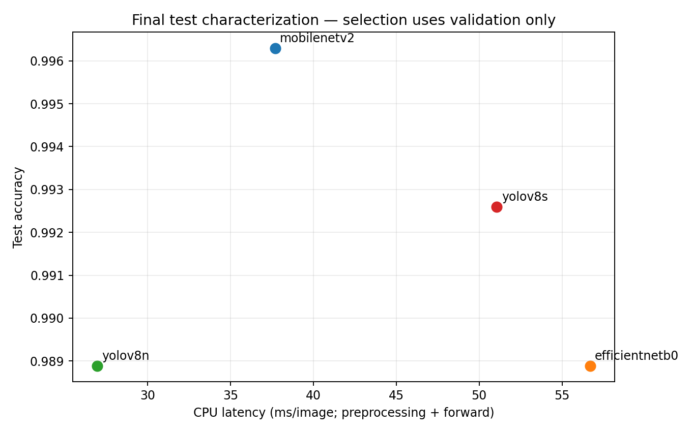
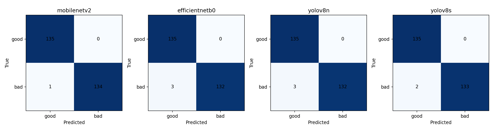

# Task 4 — Full architecture comparison

> **Audit note:** this is a reformatting of the saved results of 25 October 2026, **not a new training run**. The experiments used max 15 epochs, batch size 16, early stopping patience 4, input 224×224 for all models (including YOLO), whereas the teacher's detailed requirements specify 50/32/5 and 640×640 for YOLO. No metrics have been altered.

## Comparison (saved results only)

| Model | Epochs run | Test accuracy | Macro precision | Macro recall | Macro F1 | Mean CPU ms | Checkpoint MiB | Parameters | Train s |
|---|---:|---:|---:|---:|---:|---:|---:|---:|---:|
| MobileNetV2 | 15 | 99.63% | 0.9963 | 0.9963 | 0.9963 | 37.69 | 11.06 | 2,422,081 | 247.9 |
| EfficientNetB0 | 15 | 98.89% | 0.9891 | 0.9889 | 0.9889 | 56.69 | 18.14 | 4,213,668 | 272.4 |
| YOLOv8n-cls | 11 | 98.89% | 0.9891 | 0.9889 | 0.9889 | 26.97 | 2.83 | 1,440,850 | 232.3 |
| YOLOv8s-cls | 7 | 99.26% | 0.9927 | 0.9926 | 0.9926 | 51.07 | 9.78 | 5,083,298 | 176.0 |

The epoch-inclusive CSV was reconstructed from the original model training histories and test metrics: [results/comparison_with_epochs.csv](../results/comparison_with_epochs.csv). All precision, recall and F1 values are recomputed mathematically from the original confusion matrices; timing, model sizes, parameter counts and training seconds come from the original evaluation files.

## Error analysis

The models made **1, 3, 3 and 2 errors** respectively, all being false accepts of defective **glare** images. There are only seven distinct misclassified test images, because the two YOLO variants share some errors. For YOLOv8n, glare recall was **25/28 = 89.29%**; the other four defect groups were correctly detected in the saved test split. We did **not** invent five separate mistakes for models making fewer than five. Genuine error JPEG files are in a [private Drive archive](https://drive.google.com/drive/folders/1D157EQQNOM6LMtnOGUvuvVyjS0v8PuOv), with model-specific links under `results/<model>/errors/`.

Potential future risk reduction includes train-only augmentation targeted at glare, fixed-split validation of a new threshold and a genuinely independent real-world test set. The 1,800 synthetic images are variants of only 300 documents, so the measured differences should not be treated as robust evidence about unseen field data.

## Choice

The original validation/cost decision selected **YOLOv8n-cls** as the fastest candidate passing all provisional gates. MobileNetV2 has the best observed test accuracy; selection was **not** made by inspecting that test comparison. The decision is justified further in [the deployment memo](decision_memo.md).
