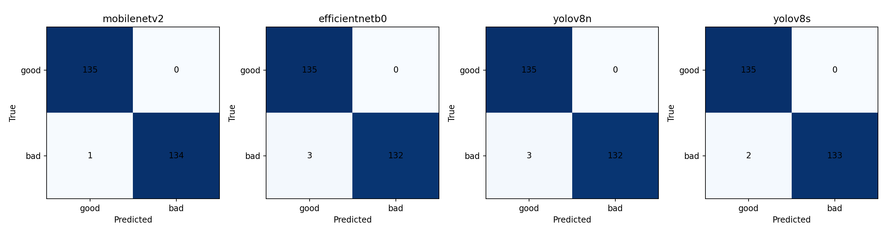
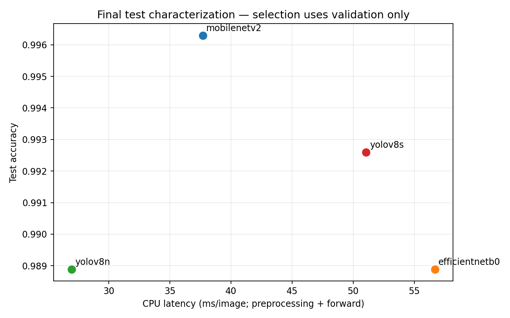
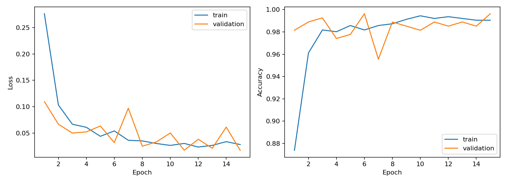
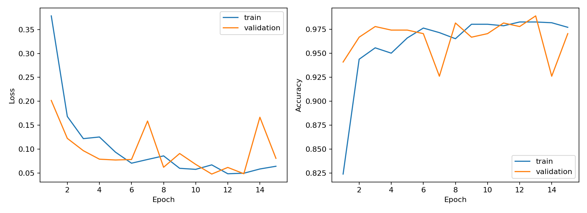
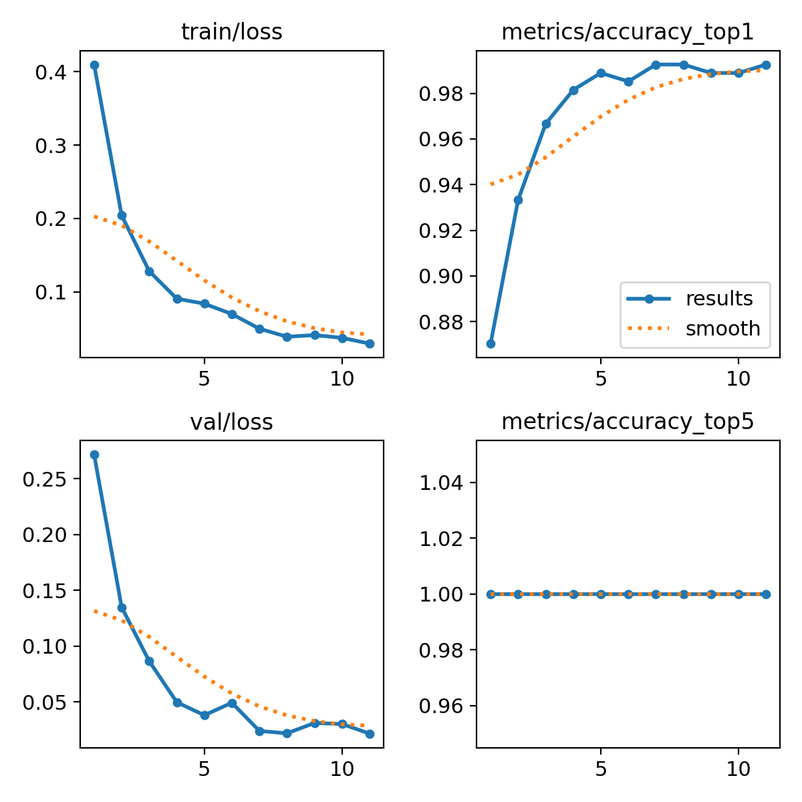
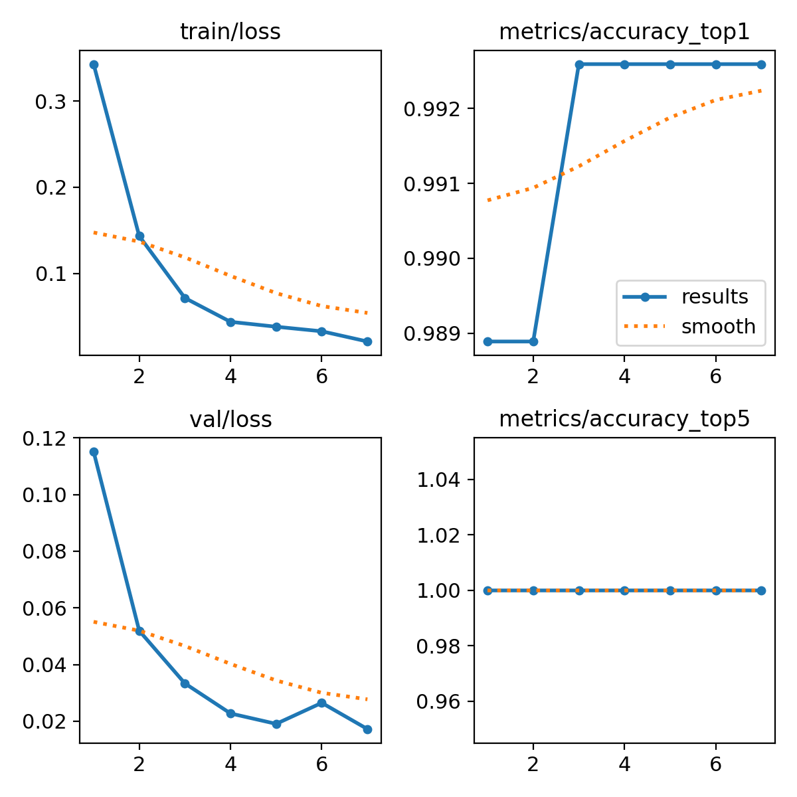
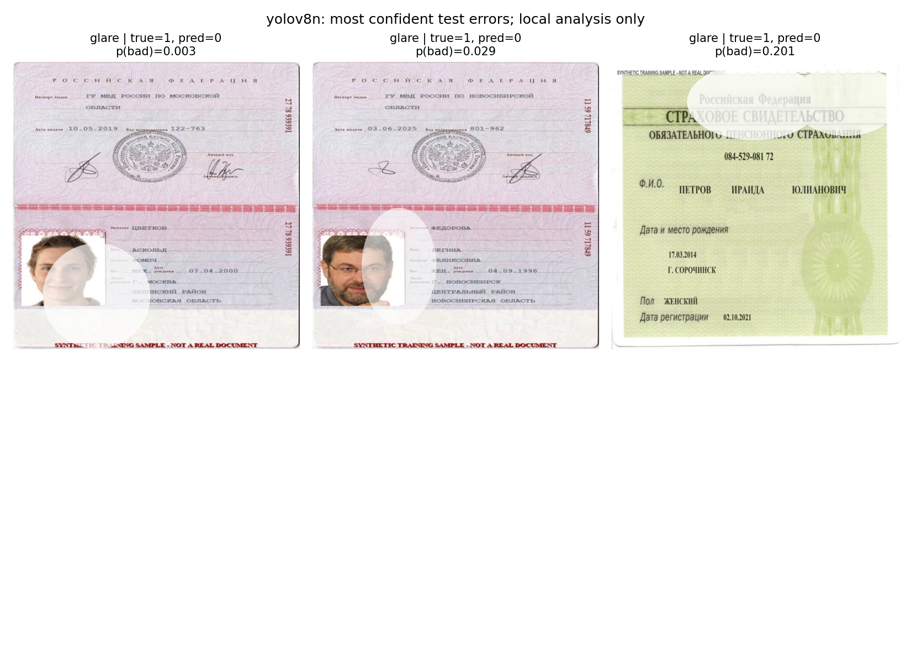

# Lab 06: Document quality classification and model selection

Student seed: **2473986**  
Experiment date: **25 October 2026**  
Task: distinguish usable document images (`good`) from defective captures (`bad`).

## 1. Experimental protocol

The dataset contains 1,800 synthetic images derived from 300 source documents. Each source contributes three good and three bad variants. The document families are INN, passport and SNILS. The unit of splitting is the source document, so related variants stay together.

| Partition | Images | Source documents | Good | Bad |
|---|---:|---:|---:|---:|
| Training | 1,260 | 210 | 630 | 630 |
| Validation | 270 | 45 | 135 | 135 |
| Test | 270 | 45 | 135 | 135 |

The 70/15/15 split replaces the earlier Lab05 audit split before this experiment. The saved manifest has no source ID or recorded image SHA256 shared across partitions. This check cannot rule out unrecorded relationships between different source documents. All models use the same manifest, whole RGB images resized bilinearly to 224 × 224, batch size 16, seed 2473986 and a maximum of 15 epochs. No new augmentation changes the quality defects. The semantic positive class is bad=1 and the probability threshold remains 0.5.

## 2. Training methods

| Candidate | Initialization | Optimized parameters | Learning rate | Checkpoint criterion |
|---|---|---|---:|---|
| MobileNetV2 | ImageNet | Classification head only | 0.001 | Lowest validation loss |
| EfficientNetB0 | ImageNet | Classification head only | 0.001 | Lowest validation loss |
| YOLOv8n-cls | Pretrained classifier | Full model | 0.0001 | Ultralytics validation fitness |
| YOLOv8s-cls | Pretrained classifier | Full model | 0.0001 | Ultralytics validation fitness |

Both Keras models use global average pooling, a 128-unit ReLU dense layer, dropout 0.3 and one sigmoid output. Their frozen backbones run in inference mode. MobileNetV2 receives values scaled to −1…1 inside the model. EfficientNetB0 receives 0…255 values and uses its built-in rescaling. The YOLO classifier receives 0…1 tensors and uses a custom whole-image resize transform. Evaluation reads the YOLO class names to map its output to the shared bad=1 convention.

All models use Adam and early stopping patience 4. The pipelines differ in optimized parameter counts, learning rates, stopping criteria and framework implementation. The experiment compares complete pipelines and does not isolate the causal effect of backbone architecture. See [the original model-selection memo](../docs/Model_Selection_Memo.md) for the rationale and references.

## 3. Final test results

All candidates completed training before final test evaluation. The following results use 270 held-out images, including 135 bad captures. Checkpoints and the recommendation use validation data. Test results provide final characterization and do not trigger tuning or reselection.

| Model | Accuracy | Precision bad | Recall bad | F1 bad | Macro F1 | Missed bad |
|---|---:|---:|---:|---:|---:|---:|
| mobilenetv2 | 0.9963 | 1.0000 | 0.9926 | 0.9963 | 0.9963 | 1 |
| efficientnetb0 | 0.9889 | 1.0000 | 0.9778 | 0.9888 | 0.9889 | 3 |
| yolov8n | 0.9889 | 1.0000 | 0.9778 | 0.9888 | 0.9889 | 3 |
| yolov8s | 0.9926 | 1.0000 | 0.9852 | 0.9925 | 0.9926 | 2 |

All four models correctly accept the 135 good images. Their errors are false accepts: defective images classified as good. MobileNetV2 has the highest observed test accuracy, with one error. A difference of one image changes accuracy by about 0.37 percentage points. With only 45 independent test sources and correlated variants, these small differences do not establish a statistically reliable ranking.

Rows show true labels and columns show predictions, in good/bad order.

## 4. Speed, size and training cost

Training used a Tesla T4. The common inference benchmark deliberately uses CPU, batch one, four configured framework threads, 20 warm-up calls and 100 timed calls. It cycles through up to 32 decoded validation images in RAM. Each call includes resize, tensor conversion, model inference and host probability output. It excludes disk I/O, image decoding and model loading. The GPU inference times printed by Ultralytics during validation measure a different scope and must not replace these CPU measurements.

| Model | Mean CPU ms | Median ms | p95 ms | Checkpoint MiB | Parameters | Training s |
|---|---:|---:|---:|---:|---:|---:|
| mobilenetv2 | 37.69 | 36.31 | 47.82 | 11.06 | 2,422,081 | 247.9 |
| efficientnetb0 | 56.69 | 55.23 | 71.87 | 18.14 | 4,213,668 | 272.4 |
| yolov8n | 26.97 | 26.60 | 32.05 | 2.83 | 1,440,850 | 232.3 |
| yolov8s | 51.07 | 49.48 | 59.62 | 9.78 | 5,083,298 | 176.0 |

Checkpoint sizes measure actual saved files. Keras serialization can include optimizer state, while Ultralytics strips optimizer state. These sizes describe deliverable artifacts rather than equally encoded raw weights. Parameters refer to the saved unfused models. CPU host load and framework overhead affect timing. YOLOv8s finishes training sooner because early stopping ends its run after seven epochs, while YOLOv8n runs eleven epochs. This does not show that a small-model epoch costs more than a large-model epoch.

## 5. Validation-based recommendation

The predeclared engineering targets are accuracy ≥0.90, bad-class F1 ≥0.90, bad recall ≥0.95, mean CPU latency ≤50 ms and checkpoint size ≤100 MiB. These are provisional project targets, not numerical requirements supplied by the teacher. Precision is reported without an independent cutoff. The rule selects the fastest candidate meeting every validation and cost target.

| Model | Validation accuracy | Validation F1 bad | Validation recall bad | Cost and validation gates |
|---|---:|---:|---:|---|
| mobilenetv2 | 0.9963 | 0.9963 | 0.9926 | Pass |
| efficientnetb0 | 0.9815 | 0.9811 | 0.9630 | Fail: mean CPU latency >50 ms |
| yolov8n | 0.9926 | 0.9925 | 0.9852 | Pass |
| yolov8s | 0.9926 | 0.9925 | 0.9852 | Fail: mean CPU latency >50 ms |

**Recommendation: YOLOv8n-cls.** It passes every validation and cost target and has the lowest measured mean CPU latency, 26.97 ms per image. Its final test bad recall is 0.9778 and bad-class F1 is 0.9888. It also passes the same provisional gates on final test characterization. This observation does not change the selection rule.

MobileNetV2 is the measured alternative when accuracy is prioritized over the lowest latency. It also passes the declared gates. EfficientNetB0 and YOLOv8s exceed the mean CPU budget in this run. YOLOv8s is close to the boundary at 51.07 ms, so a separate deployment benchmark could clarify its cost on target hardware. The current decision retains the original mean-latency rule and does not substitute its lower median after seeing the results.

## 6. Learning curves

MobileNetV2 learns quickly, with training loss falling from 0.2761 to 0.0283. Validation loss fluctuates but reaches its minimum, 0.0173, at epoch 15. Both accuracies remain high. There is no sustained divergence that would justify a strong overfitting claim. Validation accuracy exceeding training accuracy can occur because training uses dropout and metrics accumulate while weights change.

EfficientNetB0 reaches its lowest validation loss at epoch 11, about 0.0479. Later validation loss fluctuates, rising to 0.1666 at epoch 14 and ending at 0.0807. This supports concern about validation instability and possible overfitting, but does not identify its cause. Final evaluation loads the epoch-11 best checkpoint rather than the final-epoch weights.

YOLOv8n training and validation losses both decrease overall. Its validation top-1 accuracy first reaches its best level at epoch 7, and patience 4 stops the run after epoch 11. YOLOv8s reaches its best validation top-1 level at epoch 3 and stops after epoch 7. Validation loss continues to improve in some later epochs, but checkpoint selection and stopping follow validation fitness rather than loss. Top-5 accuracy equals 1 with only two classes and offers no useful discrimination here.

## 7. Failure analysis

Every observed test mistake across the four models belongs to the glare category. For the selected YOLOv8n model, glare recall is 25/28 = 0.8929. It detects all measured blur, exposure, occlusion and skew examples, with respective supports of 29, 27, 26 and 25. A perfect score on these small synthetic subsets is not evidence of perfect robustness.

The gallery shows glare covering parts of a portrait or printed fields. YOLOv8n assigns bad probabilities as low as 0.003 to one defective example. This is an observed confidence failure, not a formal calibration assessment. MobileNetV2 also misses a glare case with probability about 0.003, on a different image. A quality gate may therefore accept a damaged capture even when its aggregate score is high. Full predictions and per-defect counts accompany this report.

## 8. Reproducibility and limitations

The uploaded run records Python 3.13.16, TensorFlow 2.21.0, Ultralytics 8.4.189, PyTorch 2.11.0+cu130 and torchvision 0.26.0+cu130. `environment.json` and `environment.txt` record the remaining versions. `protocol.json`, the source manifest, checkpoint hashes, raw probabilities, epoch histories and timing samples accompany the results.

The logs include a TensorFlow layout-optimization failure followed by continued training, intentional GPU-hiding diagnostics during CPU evaluation, slow mounted-drive reads and NumExpr thread-limit messages. All four evaluations returned results. The NumExpr warning does not by itself verify or invalidate the separately configured framework thread counts, and the run is not a controlled hardware certification.

The review recomputed every validation/test confusion matrix and metric from saved probabilities, checked fixed-threshold predictions and recomputed latency means. It checked source IDs and recorded hashes across splits. The review archive excludes image datasets and checkpoint bytes, so the reviewer could not rerun inference or re-hash the saved model files. Original weights remain in the student's Colab/Drive output and must be retained.

Only 300 source documents exist, and synthetic defects do not cover real capture conditions. Different source IDs may still share visual templates. No results establish real-world deployment readiness or the superiority of one architecture in general. A later experiment can test targeted glare treatment or low-rate backbone fine-tuning with a fresh final holdout. The current test set must not become a tuning set.

## 9. Submission contents

The package contains implementation code, the original pre-run memo, an unexecuted training workflow, an executed results-review notebook, measured results and an editable five-minute presentation with speaker notes. The review notebook executes analysis of the supplied files and does not claim to have trained the models again. The presentation requires delivery by the student, and repository acceptance and the oral defense remain the teacher's decisions.
